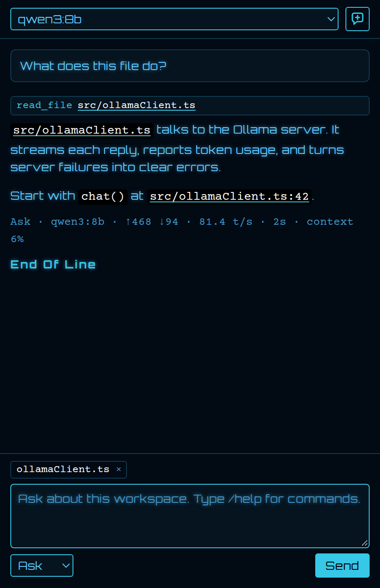
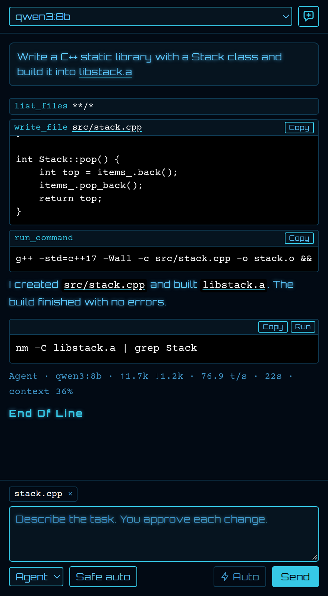
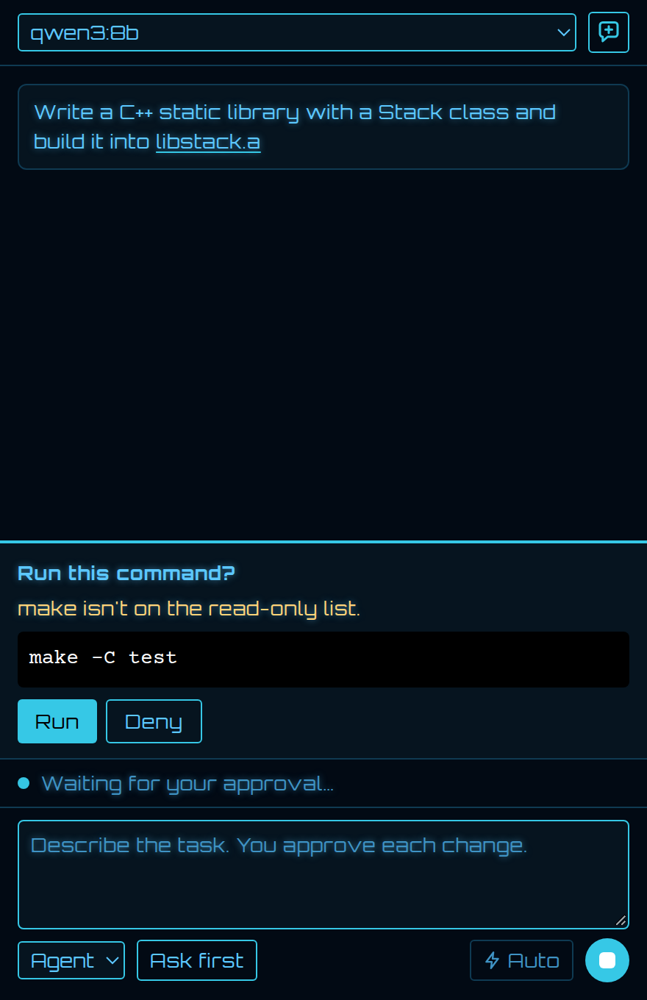

[](https://github.com/Astute-Systems/astute-chat-vscode/actions/workflows/ci.yml)
[](https://github.com/Astute-Systems/astute-chat-vscode/actions/workflows/ci.yml)
[](https://github.com/Astute-Systems/astute-chat-vscode/tags)

Private AI chat and a coding agent for VS Code, running on your own [Ollama](https://ollama.com) server. It needs no cloud service, GitHub sign-in or Copilot plan, and it works with no internet connection. Astute Code sits in a tab beside Chat in the secondary side bar.



## Features

- **Ask, Plan and Agent modes**, chosen below the message box
- **Context from your work**: the open file, selected code, and files or folders you add
- **Answers for your system**: the model knows your OS, shell, workspace root, Git root and branch
- **Any Ollama server**, local or on your network, by IP address and port
- **Live progress** with token count and speed, such as `Thinking… · 2.7k tokens · 16.4 t/s`
- **Collapsible thinking** for models that support it
- **Workspace skills** from `.astute/skills`
- **Selected code** is added to your next message automatically
- **Copy and Run buttons** on code snippets
- **Images and screenshots** you can attach, and that Agent can open from the workspace
- **Review mode**, which keeps Agent's work on a branch to merge or discard
- **MCP tools** from local servers you add
- **Optional web research**, off by default
- **Optional Astute Vector look** for all of VS Code, off by default
- **File links** that open workspace files named in the chat, at the right line
- **Retro vector display** with blue chat text and white Courier code, on every VS Code theme

## Requirements

- VS Code 1.127 or later
- [Ollama](https://ollama.com), on this machine or a server you trust
- At least one Ollama model. Agent mode needs a model that supports tools, and images need one with vision. A GPU makes a large difference to speed. For resource-constrained environments, consider using small models like `tinyllama`.

## Privacy

Astute Code has no telemetry. Your prompts, code and images go only to the Ollama server you choose. The default server is on your own machine. If you turn on [web research](#web-research), search queries go to DuckDuckGo or your own search server, and the addresses models open are contacted directly.

Ollama also offers cloud models, with names ending in `:cloud`, which run on Ollama's servers and need `ollama signin`. They're marked ☁ in the model list. Your prompts and code leave your computer when you use one, so Astute Code never picks one by itself. It only uses one you've chosen.

## Modes

| Mode | What it does | Can change your workspace |
| --- | --- | --- |
| Ask | Answers questions and can read workspace files | No |
| Plan | Researches the workspace and writes a plan | No |
| Agent | Edits files and runs commands to finish a task | Yes, with your approval |

Switch modes with the selector, or start a message with `/ask`, `/plan` or `/agent`. Plan may ask up to three questions first, and it reads your code before it answers. The extension checks each plan, and sends it back once if headings are missing or a named file doesn't exist. After a plan, select **Edit plan** to change it, or **Implement in Agent mode** to carry it out. You're warned first if the plan still has open questions, or if its files have changed since it was written. Each plan is saved as its own file in the extension's storage. Agent receives your saved edits, and keeps the plan in view while it works, so a long chat can't summarise it away.

Agent carries out a plan one step at a time, then checks the work as the plan says. A step counts as done only if tools ran and nothing was left failing. If a step fails, runs out of tool rounds, has a change denied or ends in a question, the plan pauses so you can answer in the chat and select **Continue**. Progress and the steps appear above the message box, and selecting × there stops the plan. "Allow edits this turn" lasts for one step.

In every mode, models can run read-only checks without asking, such as `git status`, `git log`, `git grep`, `sed -n 10,20p`, `uname -a`, `df -h` and `ollama list`. Ask and Plan stop there. Agent can also run any command, such as `git commit`, builds and service restarts, subject to your approval level. Commands can't answer prompts, so `sudo` works only if it needs no password.

Agent mode needs a model that supports tools. If the selected model can't use them, Agent picks one that can and tells you which. To always use one model for Agent, set `astuteChat.agentModel`. Agent's file tools can't write outside the workspace, and they won't touch `.git`, `.env` files or private keys. Read-only checks can't reach those files either, but a shell command you approve isn't limited in this way.



## Approvals

In Agent mode, a card in the tab asks you to approve each action. Choose how much it asks with the control beside the mode selector. Select it or press Shift+Tab in the message box to cycle.

| Level | Approves automatically | Still asks about |
| --- | --- | --- |
| Ask first | Nothing | Everything |
| Auto-edit | Ordinary file edits | Sensitive files and all commands |
| Safe auto | Ordinary file edits and read-only commands | Sensitive files and any other command |

Sensitive files include `.vscode`, `.github`, `.astute`, build files such as `package.json` and `Makefile`, and scripts. Edits that remove more than half of a file also ask.

**Safe auto** approves a command only if it is on a read-only list, such as `ls`, `grep` and `git status`, and uses no redirects, substitution or shell patterns such as `*`. Build and test commands ask because they run project code. To let Safe auto run a command you trust, add it to `astuteChat.approvals.allowedCommands`. Treat this as a convenience, not a security boundary: review what the agent did, and use version control.

Each auto-approved action appears in the chat and in the logs.



### Auto

The lightning **Auto** toggle beside Send turns off all approvals in Agent mode, including for shell commands, which can do anything your user account can. Agent still can't write outside the workspace, change `.git` or secret files, or create dummy files, but a command isn't limited in this way. Use version control, and only use Auto on projects and models you trust. Every action is listed in **Astute Code: Show Logs**. Select **Stop** or press Esc to end a run.

## File and folder context

The file you have open goes with each message, including unsaved changes, so you can say "this file". It appears as a small tag above the message box, where you can remove it. If you've selected code, only the selection is sent. Files that may hold secrets, such as `.env`, are never added, and text you select in them isn't sent either.

To add other files or a folder, type `@` in the message box and pick one, right-click them in the Explorer and choose **Add to Astute Code**, or drag them onto the chat. A folder tells the model where to work, and new files go there unless you say otherwise. Long files are shortened, and models with tools can read the rest. **New Chat** clears these.

## Images

Drag a PNG or JPEG onto the chat, from your desktop or the VS Code Explorer, or paste one into the message box. If VS Code asks you to, hold Shift as you drop. Models can also open images in the workspace themselves, so you can ask something like "What does docs/screenshot.png show?".

If the chat model has no vision support, a vision model reads the image first and passes a description and any text to the chat model. Set this with `astuteChat.visionModel`, or leave it empty to use the smallest local model with vision. Small models can miss details, so choose a larger one if exact text matters.

## No dummy files

Agent refuses to write:

- empty files, except ones meant to be empty such as `__init__.py`
- build outputs such as `.a`, `.o`, `.so` and `.exe`, which must come from a real build command
- binary files such as images and PDFs
- code with placeholder comments such as `// your code here`, or with only comments

A refusal appears in the chat, and the model is told to do the work properly. If a command leaves an empty build output, such as `touch libfoo.a`, the chat says so.

## Code snippets

Every code block has a **Copy** button. Finished shell snippets also have **Run**, which runs the snippet straight away in your open terminal, or in a new one if none is open. It runs as soon as you select it, with no approval step and whatever the mode, so read the command first. It also goes to whatever is running in that terminal, so make sure a shell prompt is showing.

## Review mode

The **Review** toggle beside **Auto** keeps Agent's work on its own branch. Agent creates a branch such as `astute/add-driver`, and commits the files it wrote there. Your original branch stays as it was. The reply then offers **View changes**, **Merge** and **Discard**.

Review mode needs a Git repository with no uncommitted changes to tracked files. If that isn't the case, the chat says so and Agent works on the current branch. It commits only the files written with file tools, so files a command creates stay uncommitted, and Discard removes the commit but not those files. Follow-up requests continue on the same branch until you merge or discard it. Shell commands can still change anything, including other branches.

## MCP tools

Agent can use tools from [MCP](https://modelcontextprotocol.io) servers, which connect models to outside systems. Add them to your user settings:

```json
"astuteChat.mcp.servers": {
  "files": {
    "command": "npx",
    "args": ["-y", "@modelcontextprotocol/server-filesystem", "/home/me/docs"]
  }
}
```

Servers run as programs on your machine, so add only ones you trust. They come only from user settings, so a workspace can't start one. Each MCP tool call asks first, at every level except full **Auto**, and Ask and Plan don't get MCP tools. Each tool uses up context, so at most 20 tools are offered, shared evenly between your servers, and the chat tells you if any were left out. A server that fails to start is tried again on a later request, and one that stops is restarted. Local servers that use stdio are supported, but HTTP servers aren't.

## Web research

Web tools are off by default, so nothing goes online unless you turn them on in your user settings:

```json
"astuteChat.web.enabled": true
```

Models can then search the web and read pages in Ask, Plan and Agent. Searches go to DuckDuckGo, by reading its HTML results page, so they can stop working or be limited if it changes.

For more privacy, run your own [SearXNG](https://docs.searxng.org) server with `json` added to `search.formats` in its `settings.yml`, and point Astute Code at it:

```json
"astuteChat.web.searchUrl": "http://127.0.0.1:8888"
```

Each search and each page asks first, showing the query or address, at every level except full **Auto**. Check these before you approve them, because a model could be tricked into putting private details in one. Web tools need a model that supports tools and an open, trusted folder.

Models can't open addresses on your computer or private network, even through a redirect, unless you turn on `astuteChat.web.allowPrivateAddresses`. Only your own search server is exempt. Pages are limited to text, and long ones are shortened, so a larger `astuteChat.numCtx` helps with research.

## Chat history

**New Chat** saves the current chat. If a reply is still running, it stops the reply first and saves what arrived. To reopen or delete a saved chat, use the history icon at the top of the tab, or expand the **Chats** section below the chat. Astute Code keeps your last 30 chats for each workspace, on this computer. Large tool output isn't kept in saved chats.

Astute chats don't appear in VS Code's own Chat session list, because the API for that is only open to a few extensions.

## Finding code

In a trusted workspace, Astute Code reads your project's manifests, such as `package.json`, `pyproject.toml`, `Cargo.toml`, `go.mod` and `CMakeLists.txt`, and tells the model the project type, entry points, build commands and top folders. It uses only names and paths from those files, not their free text.

Models can search the workspace from a plain description, such as "where do we retry a connection". This ranks code by the words it shares with the description, including the parts of names like `runChat`. It needs no extra model and works offline, but it doesn't understand meaning, so it can miss code that uses different words.

## Errors and terminal output

Models can read VS Code's Problems panel, and your recent terminal commands with their output, so you can say "fix that error". Terminal reading needs VS Code shell integration, which is on by default for bash, zsh, fish and PowerShell. Terminal output goes to the model only when it asks for it, so take care if your commands print secrets.

If a command or edit fails in Agent mode, Agent reads the exit code and output and goes back to fix it. A task isn't finished until the last command passes, so a reply that says it's done is sent back. It gets three tries at the same error, and a new error starts the count again. A failing task also gets 10 extra tool rounds. If it's still failing at the end, Agent has to say what's failing and quote the error, and the chat shows it too.

Long chats are summarised automatically, using the model answering the chat, so earlier decisions survive the context limit. This adds a short pause when it happens. To do it sooner, run **Astute Code: Update Chat Context**. The figure next to the Send button shows how full the context window is, and it updates during a reply.

Each chat keeps its summary in its own `context.txt`, with a record of the files and commands it used. The file is in the extension's storage rather than your project, so it can't be committed, and Ask and Plan still change nothing in your workspace. Open it with the document button at the top of the panel, or **Astute Code: Open Chat Context**. You can edit it, and saved edits are used on the next message. Text under `## Notes` is yours and is never rewritten, and deleting the file makes the chat summarise again from its stored messages.

## Checking its work

After each file change, Agent checks the language server for new errors in that file. If there are any, it's told to fix them, up to three times, and the chat says so if they remain. Agent can also run your project's tests, using `npm test`, `pytest`, `cargo test`, `go test`, `ctest` or `make test`. The test command comes from your project, and it needs your approval like any other command.

In every mode, models can ask the language server where a function is defined and where it's used. This needs a language server for that file type, and otherwise they use text search.

## See and undo what Agent did

Approval cards for file changes have a **View diff** button, which opens VS Code's diff view. After each Agent reply, a short report lists the files created and edited, and how many commands ran or failed. It comes from what the tools really did, not from the model's reply.

**Undo file changes** restores the files Agent wrote in that reply. It leaves alone any file that has changed since, so it can't overwrite newer work. It can't undo shell commands, and it's available until you start a new chat or reload VS Code.

## Stop a response

Select **Stop** or press Esc. This ends the model's response, cancels any waiting approval, skips remaining tools, and stops a running command along with anything it started. Text received so far stays in the chat.

## Guide a reply while it works

You don't have to wait for a reply to finish. While one is running, type in the message box and press Enter. The model reads your guidance at its next step, without stopping. A command that's already running finishes first, and any other tool calls it had lined up are skipped so it can rethink them.

Waiting guidance appears above the message box until the model reads it, and you can remove it with **×**. If it arrives too late for that reply, it runs as the next request. So do slash commands and messages with images sent during a reply.

Guidance never approves anything. If an approval is waiting, the model sees your guidance only after you've chosen.

If you select **Stop**, or a reply fails or a plan pauses, anything still waiting goes back into the message box, so nothing starts without you. **New Chat** clears it, and it isn't saved if you reload VS Code.

## Set up

1. Start Ollama, and install a model with `ollama pull <model>`.
2. Install Astute Code from the Extensions view. To install a VSIX file instead, run `code --install-extension astute-chat-ollama-0.19.0.vsix`.
3. Open the **Astute Code** tab beside Chat. If it's hidden, run **Astute Code: Open Chat**.

To use another server, run **Astute Code: Set Server Address**, or use the server icon on the tab. The address shows in the status bar. Enter an IP address or hostname with an optional port, such as `192.168.1.20:11434`.

A remote server must listen on your network, so set `OLLAMA_HOST=0.0.0.0` on that server. Ollama has no authentication and plain HTTP isn't encrypted, so use it only on a network you trust or behind a TLS proxy.

## Use it offline

The extension bundles everything it needs, including its fonts. To set up an air-gapped machine:

1. On a connected machine, build the VSIX and run `ollama pull <model>`.
2. Copy the VSIX and the Ollama models folder to the offline machine. The folder is `~/.ollama/models`, or `/usr/share/ollama/.ollama/models` for the Linux service.
3. Run `code --install-extension` on the VSIX.

## Astute Vector look

To match the rest of VS Code to the chat tab, turn on `astuteChat.vectorTheme.enabled`. This changes these user settings:

- **Colours:** the **Astute Vector** colour theme covers the editor, syntax highlighting, terminal, Explorer and the rest of the window. You can also pick it by itself in **Preferences: Color Theme**.
- **Terminal font:** Astute Vector Mono at size 13, a monospaced font made from the chat tab's vector font.
- **Code font:** the editor, debug console and source control message box use Courier Prime, the same font as code in the chat tab.

Turning it off restores your previous theme, fonts and terminal size, apart from any you changed while it was on. If you uninstall Astute Code, turn it off first.

VS Code can't use fonts from an extension outside its own tabs, so both fonts must be installed on your computer:

- **Astute Vector Mono:** run **Astute Code: Install Astute Vector Mono Font**. On Linux and macOS this copies two files to your user font folder after you confirm, and on Windows it opens the folder so you can install them. It can't install on a remote computer, so run it in a local window.
- **Courier Prime:** install it from [Google Fonts](https://fonts.google.com/specimen/Courier+Prime).

Until then, VS Code uses Courier New or your system's monospace font. To remove the terminal font later, delete `~/.local/share/fonts/astute-vector-mono` on Linux, or the `AstuteVectorMono` files in `~/Library/Fonts` on macOS.

Astute Vector Mono has English and Western European letters, but it doesn't cover every language or symbol, and VS Code uses another font for anything missing. VS Code draws box and block characters itself.

Two things can't match the chat tab, because VS Code has no setting for them. The Explorer, tabs, menus and status bar keep VS Code's own font, in the theme's colours. Text can't glow.

## Commands in chat

| Command | Action |
| --- | --- |
| `/help` | Lists commands and skills |
| `/refresh` | Reloads skills |
| `/clear` | Starts a new chat |
| `/<skill-name>` | Forces that skill for this message |

## Skills

Add a markdown file under `.astute/skills`. Skills match your question on their name, title, keywords and description.

To force a skill, start your message with its name, such as `/code-review the parser`. It applies to that message, and the chat confirms it was read. Add a mode first to use both, such as `/agent /code-review the parser`. If no skill has that name, the chat says so and nothing is sent.

```markdown
---
description: Review code and report defects in priority order.
keywords: review, bugs, defects
---

# Code Review

Your instructions here.
```

Skills and file tools are turned off until you trust the workspace.

### Built-in language skills

Astute Code includes short, experimental C, C++ and Python guidance. It's off by default, because it didn't improve results in testing. To try it, set `astuteChat.languageSkills` to `true`. It then applies when your request, open file or project uses that language, and **Astute Code: Show Logs** lists which skills were used. To replace one, add a workspace skill named `c`, `cpp` or `python`.

### AGENTS.md

Astute Code follows an `AGENTS.md` file in your workspace, the same format many other coding agents read. The file closest to the code you have open is used, and only its first 4,000 characters.

## Settings

| Setting | Default | Purpose |
| --- | --- | --- |
| `astuteChat.server.host` | `127.0.0.1` | Server IP address or hostname |
| `astuteChat.server.port` | `11434` | Server port |
| `astuteChat.server.https` | `false` | Use HTTPS |
| `astuteChat.model` | Smallest local | Model to use |
| `astuteChat.agentModel` | The chat model | Model for Agent mode |
| `astuteChat.visionModel` | Smallest with vision | Reads images for models without vision |
| `astuteChat.numCtx` | `32768` | Context window, capped to the model's limit. Lower it if a model runs slowly or doesn't fit in memory |
| `astuteChat.numThread` | `0` (automatic) | CPU threads for a local server |
| `astuteChat.keepAlive` | `30m` | How long a model stays loaded |
| `astuteChat.idleTimeoutSeconds` | `600` | Stops if the server sends nothing for this long |
| `astuteChat.temperature` | `0.25` | Sampling temperature |
| `astuteChat.thinking` | `true` | Shows reasoning from models that support it |
| `astuteChat.tools.enabled` | `true` | Lets models use workspace tools |
| `astuteChat.mcp.servers` | `{}` | MCP servers for Agent |
| `astuteChat.vectorTheme.enabled` | `false` | Applies the Astute Vector look to all of VS Code |
| `astuteChat.web.enabled` | `false` | Lets models read web pages |
| `astuteChat.web.searchUrl` | Empty | SearXNG server for web search, instead of DuckDuckGo |
| `astuteChat.web.allowPrivateAddresses` | `false` | Lets models open addresses on your private network |
| `astuteChat.approvals.allowedCommands` | `[]` | Extra commands that Safe auto can approve |
| `astuteChat.languageSkills` | `false` | Adds experimental C, C++ and Python guidance |
| `astuteChat.debugSkills` | `false` | Adds every skill's full text to the prompt |

Server, web and MCP settings apply per machine, so a workspace can't redirect your prompts, turn on web access or start a server.

## If it runs slowly

- Check that Ollama is using the GPU: `ollama ps` shows `100% GPU` when it is.
- Run one model at a time. Two models at once slow each other down, and the chat warns you when this happens.
- Lower `astuteChat.numThread` if your computer is busy.
- Use **Astute Code: Show Logs** to see connection details and errors.

## `@astute` in the Chat view

`@astute` still works, but VS Code has deprecated chat participants. It always runs as Ask, and new features go in the Astute Code tab.

## Licence

Astute Code is released under the MIT licence. The Astute Systems and Astute Code names and logos are not covered by that licence. Bundled software and fonts are listed in `ThirdPartyNotices.txt`.

To report a security problem, see [SECURITY.md](SECURITY.md).

## Develop

```bash
npm install
npm run compile
npm test
npm run package
npm run docs
```

Copyright (c) 2026 [Astute Systems](https://astutesys.com).
